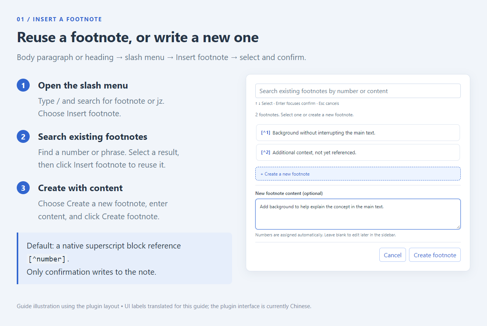
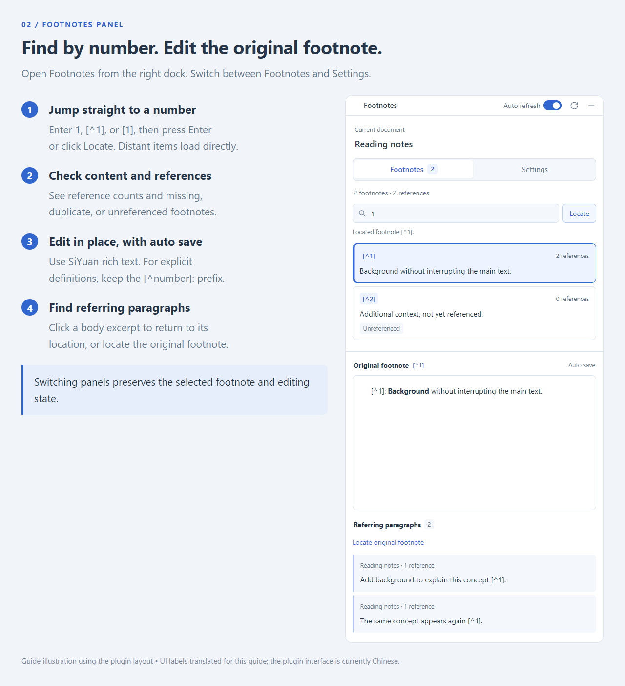
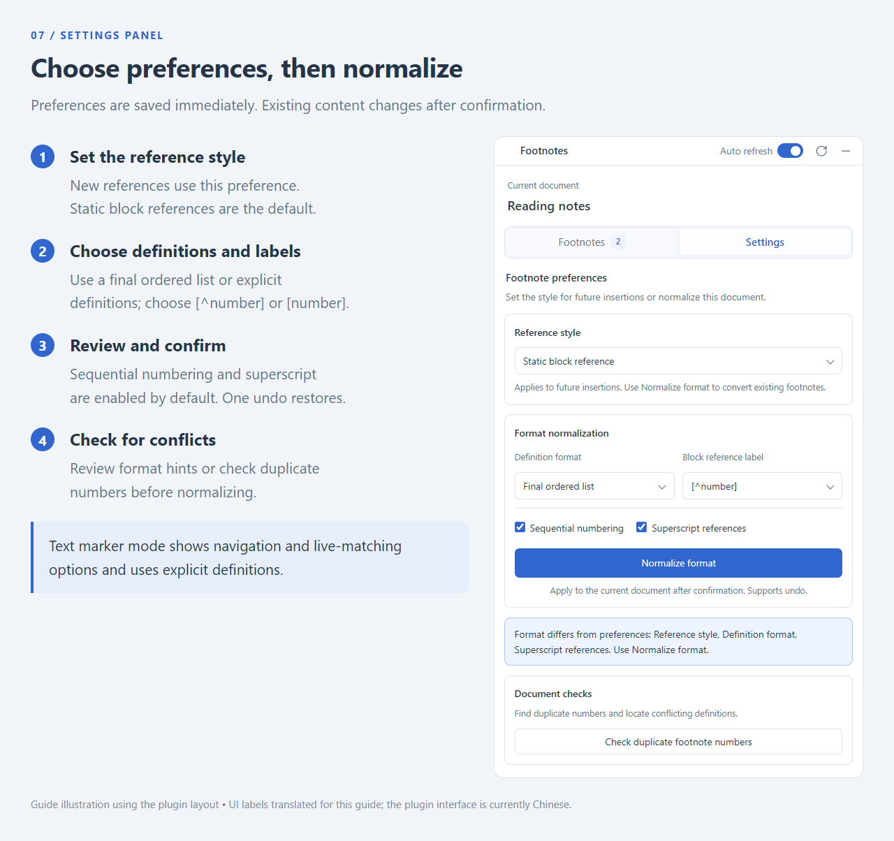
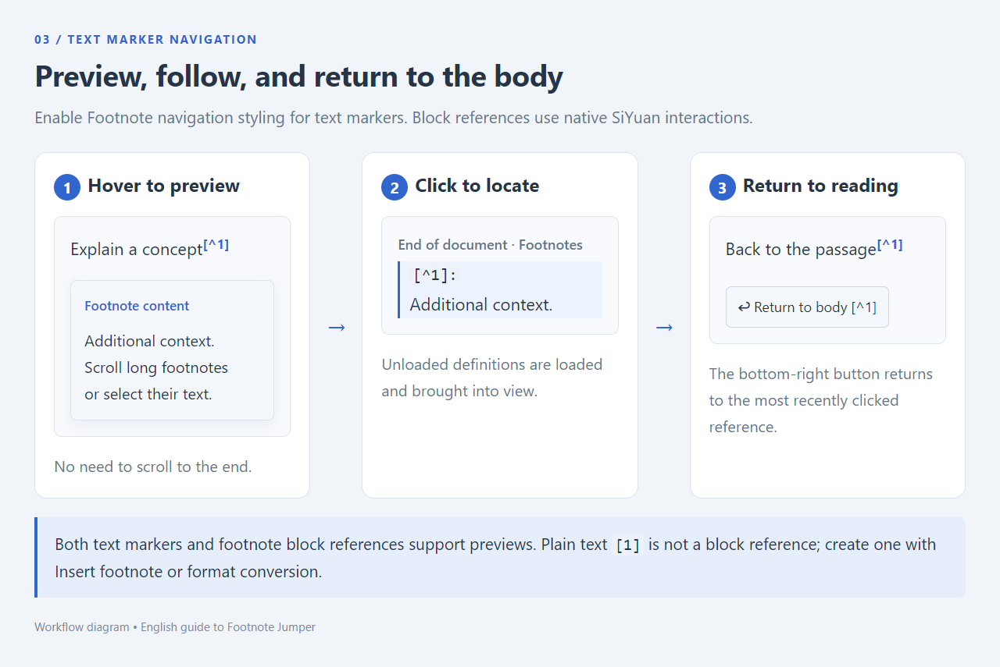
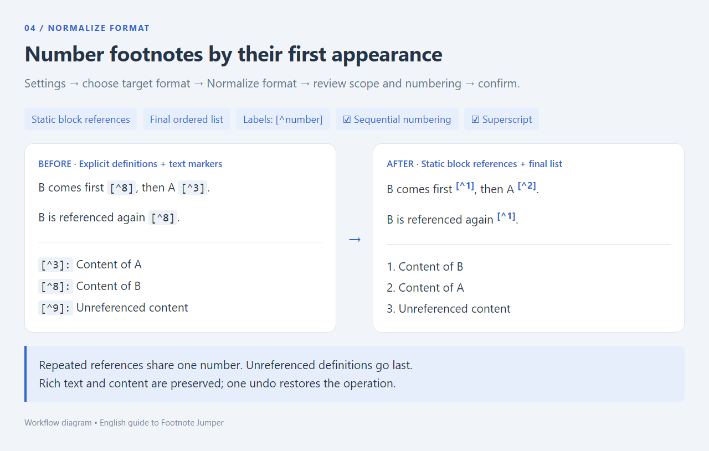
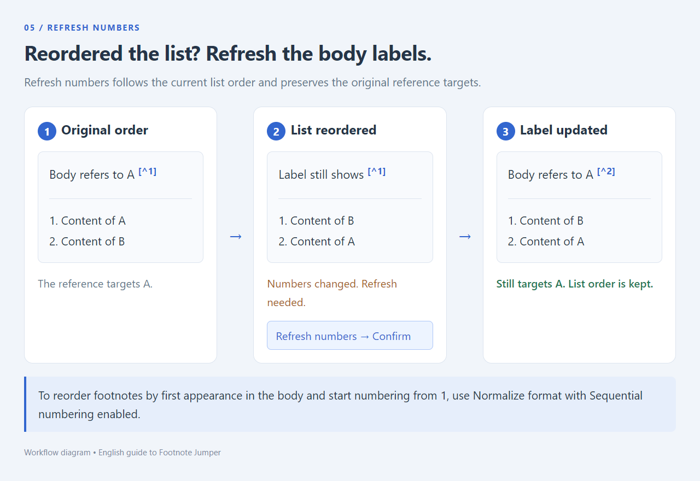
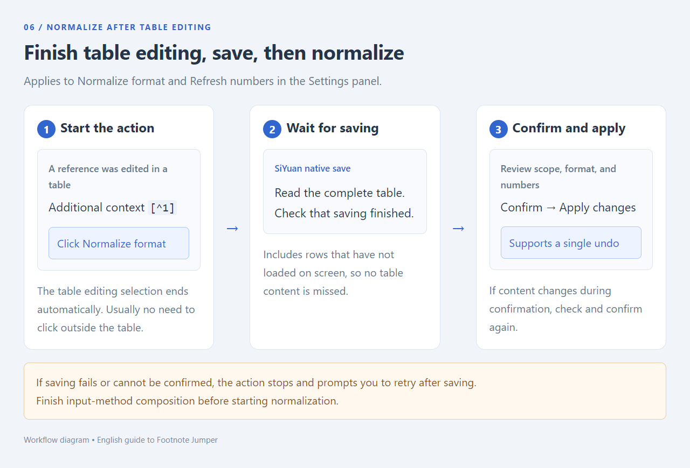

# Footnote Jumper

English | [简体中文](README.md)

Insert, preview, and manage footnotes in SiYuan: follow references from the document, edit footnote content directly in the sidebar, find referring paragraphs, normalize reference styles, switch definition formats, and renumber footnotes.

The plugin interface currently uses Chinese. The illustrations use English annotations and translated UI labels for this guide. English control names below include the corresponding Chinese labels so you can find them in the interface.

## Quick start



1. Enable the plugin and open the document where you want to add footnotes.
2. Type `/` in a body paragraph or heading, search for “脚注”, “footnote”, or “jz”, and choose **Insert footnote (插入脚注)**.
3. Search existing footnotes by number or content, or enter new content and click **Create footnote (新建脚注)** to assign a number automatically. References follow the sidebar preference. By default, they are static block references labeled `[^number]`, with native superscript formatting.
4. Creating a footnote saves its content at the end of the document and focuses the sidebar editor. You can also create an empty footnote and edit it later; changes save automatically to the original document. Reusing a footnote does not create another definition.
5. Hover over a reference to preview its content. Click a text marker to jump to its definition; block references use SiYuan’s native interactions.

Documents with existing footnotes work without reinserting references. Open the **Footnotes (脚注)** panel from the right dock. The plugin provides a sidebar entry and does not add a top toolbar icon.

## Supported footnote syntax

There are two ways to reference footnotes in the body:

| Reference style | Usage |
| --- | --- |
| Text marker `[^1]` | Type it directly in the body. The plugin provides superscript display, previews, and click navigation. |
| Static block reference `[^1]` / `[1]` | Created by Insert footnote or format conversion. It points to the footnote, displays `[^1]` by default, and uses SiYuan’s native hover preview. |

Use **Normalize format (统一格式)** to switch block reference labels between `[^1]` and `[1]`. **Typing plain text `[1]` does not create a footnote reference.**

Footnote content supports the following two definition formats. Static block references support either format; text markers use explicit `[^number]: content` definitions.

### Format 1: `[^number]: content`

Use the same number in the body reference and at the start of the definition paragraph:

```markdown
This passage needs an explanation [^1].
Another passage can refer to the same footnote [^1].

## Footnotes

[^1]: Footnote content, which can include bold text, links, and other formatting.
```

### Format 2: An ordered list at the end of the document

Write the footnote content in a final ordered list. References correspond to the numbers actually displayed in the list:

```markdown
The first explanation [^1], and the second explanation [^2].

## Footnotes

1. Content of the first footnote.
2. Content of the second footnote.
```

Only a top-level ordered list at the end of the document is recognized as a footnote section. Trailing empty paragraphs are allowed. If other body content follows the list, it is no longer a final footnote list. Other lists in the body are not treated as footnotes. The list may start at any positive integer; matching uses its actual displayed numbers.

**Use one definition format per document.** When explicit `[^number]: content` definitions exist, the plugin gives them priority. It reads the final ordered list only when there are no explicit definitions.

## Inserting and editing footnotes

### Insert from the slash menu

In a body paragraph or heading, choose `/` → **Insert footnote (插入脚注)**. Search existing footnotes by number or their full content. Numbers can be entered as `12`, `[^12]`, or `[12]`. Select an item with the arrow keys or by clicking it, then click **Insert footnote** to confirm. Pressing Enter in the search field only moves focus to the confirmation button. Duplicate numbers and missing definitions display an explanation and cannot be reused. Esc or **Cancel (取消)** closes the dialog and restores the original slash selection without changing the note.

The candidate list initially renders 40 items. Scrolling near either edge loads adjacent batches while preserving existing rows and the current selection. Search and counts cover every footnote in the current document. The arrow keys can select across batches and bring the target into view. Changing the search starts again from the first batch. Closing the dialog stops scroll loading.

To create a footnote, select **Create a new footnote (新建一条脚注)**. This expands the **New footnote content (新脚注内容)** field and changes the confirmation button to **Create footnote (新建脚注)**. Enter content or leave it empty, then click the button. A number is assigned automatically, and the content is saved as plain text. Switching back to an existing footnote restores the Insert footnote button and retains your new-footnote draft. A search with no matches automatically enters creation mode; the search text is not copied into the footnote. Selecting, typing, and switching modes do not change the note until you click the confirmation button.

- If a final ordered footnote list exists, the new item is appended to it.
- With `[^number]: content` definitions, the new definition and its content are appended at the end. If there is no final footnote section, a level-two “脚注” heading is created.
- In documents without footnotes, the sidebar preference determines the definition format: static block references default to a final ordered list; text markers use explicit definitions. Existing documents keep their definition format, with a sidebar prompt to normalize any mismatch.
- Automatic numbering accounts for footnotes in SiYuan’s pending save queue. One undo restores the insertion.
- Opening the dialog and inserting do not wait for a full-document save or depend on unrelated blocks being saved. Insertion updates only the source block and appends the necessary definition or list item, without rewriting the entire footnote list. If the source or target has changed, you are prompted to try again.

### Find and edit in the sidebar

The sidebar has **Footnotes (脚注)** and **Settings (设置)** panels. Footnotes contains number lookup, the footnote list, the original block editor, and referring paragraphs. Settings contains reference preferences, normalization, format checks, and duplicate-number checks. Each panel scrolls independently. Switching panels preserves the selected footnote and editing state; incremental footnote-list rendering pauses while Settings is open.

The footnote list initially loads 40 items, and referring paragraphs initially load 30. Scrolling near the top or bottom automatically loads adjacent batches without a load button. Counts and full-document format checks always cover the whole document. Refreshing reuses unchanged list items and preserves the scroll position and original block editor. Switching the main document updates the panel; editing in the sidebar does not change which document is being managed.



The current document appears at the top. Use Footnotes to find, edit, and navigate; use Settings to save preferences, normalize formats, and check issues.

The top-right corner has an independent **Auto refresh (自动刷新)** toggle and a refresh button, available in both panels and for both reference styles. Auto refresh is enabled by default. While the sidebar is open, it updates the list, reference counts, and format hints after a short delay following edits or synchronization. Closing the sidebar stops automatic full-document reads for the panel. Opening the sidebar, or switching documents while it is visible, reads the current document once. For long documents, disable Auto refresh and use the refresh button as needed. The toggle is saved; enabling it again immediately refreshes once. The refresh button also updates body text markers. Repeated clicks are disabled during refresh, and processing is deferred during Chinese input-method composition.

Text-marker navigation and hover previews work independently of the panel toggle and can look up footnotes that have not yet loaded.

- **Footnote list:** Numbers and reference counts appear in separate columns, with content summaries and statuses for **Missing definition (缺失定义)**, **Duplicate number (编号重复)**, and **Unreferenced (未引用)**. Click a footnote to select it for editing.
- **Original footnote block (脚注原块):** Shows **Auto save (自动保存)** or **Read-only (只读)** on the right. Selecting a footnote lets you edit its original content directly, with SiYuan rich text and automatic saving. For explicit definitions, keep the leading `[^number]:` prefix.
- **Referring paragraphs (被引段落):** The heading shows how many body paragraphs refer to the footnote. Each entry shows a body summary, its parent heading, and the number of references within that paragraph. Click to navigate to the body.
- **Locate original footnote block (定位脚注原块):** Jump to the footnote’s actual location in the document.
- **Find by number:** Enter a number above the footnote list and press Enter or click **Locate (定位)** to select and display the footnote and its referring paragraphs. Accepts `12`, `[^12]`, `[12]`, and existing alphabetic identifiers. An unloaded item’s batch is loaded directly and scrolled into view without repeated clicks. Scrolling loads adjacent items; loading upward preserves the visible position. If a number has multiple definitions, repeat the lookup to cycle through them. A message appears when nothing matches.

Body block references targeting a footnote content paragraph or list item in the current document also count toward reference totals and referring paragraphs.

The panel shows guidance when no document is open or the document has no footnotes. In a document without footnotes, use the slash menu to start adding them. Until you select a footnote, the editor and referring-paragraph area prompt you to choose one.

### Save preferences and check formats in Settings



- **Reference style (引用写法):** Saved for future insertions. To convert existing content after changing the preference, click Normalize format and confirm.
- **Format normalization (格式整理):** For static block references, choose **Definition format (定义格式)** and **Block reference label (块引编号)**, then optionally enable **Sequential numbering (连续编号)** and **Superscript references (引用使用上标)**. Text markers always use explicit definitions.
- **Text marker options:** **Footnote navigation styling (脚注跳转样式)** and **Refresh while editing a block (编辑块实时刷新)** appear only in text-marker mode. Navigation styling provides matching, navigation, previews, and temporary superscript styling; disabling it preserves saved native superscripts. Refresh while editing is enabled by default and controls only body-marker matching. When disabled, matching happens on leaving the edited block; the top-right refresh button also matches immediately. This setting is independent of the panel’s Auto refresh toggle. Processing is deferred during Chinese input-method composition.
- **Format check (格式检查):** When panel data is read, the plugin checks the current document against all format preferences, lists mismatches, and suggests Normalize format. It does not rewrite content automatically or repeatedly open dialogs. Closing the sidebar stops automatic full-document reads and format checks.
- **Check duplicate footnote numbers (检查重复脚注编号):** Inspect conflicting definitions and navigate to them for correction.

## Preview, jump, and return to the body



With Footnote navigation styling enabled, body text markers appear as clickable superscripts. Hover to preview the footnote or click to locate its definition. Footnotes at the unloaded end of a long document can be previewed and reached without scrolling to the end first.

You can move the pointer from a marker into its preview. Long footnotes can be scrolled, the scrollbar can be dragged, and text can be selected. After the pointer leaves both the marker and preview, the preview closes after a short delay.

After following a text marker, a **Return to body (返回正文)** button appears at the bottom right. Click it to return to the reference you just followed. When a footnote has multiple references, it returns to the most recently clicked one.

Footnote block references use SiYuan’s native preview and navigation. Identically numbered footnotes in different documents match their own document’s definitions.

## Normalize formats and renumber footnotes

Open the Footnotes sidebar, switch to Settings, choose the target format, and click **Normalize format (统一格式)**.

| Setting | Options and effects |
| --- | --- |
| Reference style (引用写法) | **Static block reference (静态块引):** Convert references to block references targeting footnotes. **Text marker (文本标记):** Convert to `[^number]` with explicit `[^number]: content` definitions. |
| Block reference label (块引编号) | Available for static block references. Defaults to `[^number]`; can be changed to `[number]`. Changes only their displayed labels. |
| Superscript references (引用使用上标) | Enabled by default. Saves both reference styles as SiYuan native superscripts. Disabling it preserves existing superscripts and inline styles. Definitions retain normal text size. |
| Definition format (定义格式) | Available for static block references. **Final ordered list (文末有序列表):** Move definitions into a final list and remove `[^number]:` prefixes. **Explicit definitions:** Restore the prefixes and turn list footnotes into definition paragraphs. |
| Sequential numbering (连续编号) | Enabled by default. Renumber from 1 in order of first appearance in the body. Multiple references to one footnote share a number; unreferenced definitions go last. Disable to retain existing numbers. |

The default combination is static block references, a final ordered list, sequential numbering, and superscript references. The confirmation dialog shows the affected scope, target definition format, and numbering changes. After confirmation, normalization covers the whole document, including body content that has not yet loaded.

Static block reference mode uses SiYuan’s native interactions and hides text-matching options. Switching to text markers hides Block reference label and Definition format and shows navigation and refresh options. After normalization is confirmed, existing list footnotes become explicit definitions with fixed numbers, avoiding changes caused by automatic list numbering. Switching back restores the controls and their previous values. Older documents combining text markers with an ordered list remain readable; refreshing their numbers also migrates them to explicit definitions.

Conversion preserves inline formatting in references, including bold, italic, and color. Markers already using native superscript do not receive an additional layer of reduced size or raised positioning. Text markers still support navigation and previews; disabling Footnote navigation styling also preserves saved native superscripts.



In the illustration, footnote B is referenced first, so `[^8]` becomes a `[^1]` block reference. Footnote A follows and becomes `[^2]`. The second reference to B still uses `[^1]`, and unreferenced definitions are placed last.

Normalization preserves rich footnote content such as bold text and links, as well as references to the original content blocks. One undo restores the operation. When using an ordered list without Sequential numbering, existing numbers must be consecutive positive integers; otherwise, enable Sequential numbering.

### Refresh numbers after changing the list

After reordering footnotes, deleting list items, or changing the list’s starting number, Settings may report that the numbers have changed. Click **Refresh numbers (刷新序号)** and confirm to update body labels to the current footnote numbers while preserving reference targets and list order.



In the illustration, A moves to the second list item. Its body block reference still targets A, but the displayed label needs to change from `[^1]` to `[^2]`. Refresh numbers updates that label without moving A back to the first item.

Static block reference labels do not automatically change when the list is reordered, so check for this prompt after list edits. To reorder definitions by first appearance in the body and number from 1, use Normalize format with Sequential numbering enabled.

## Preferences and format hints

The plugin saves reference style, definition format, block reference labels, sequential numbering, superscript, panel Auto refresh, and the text-mode navigation and refresh-while-editing toggles. Switching reference styles preserves previous choices.

Panel format checks read only the current document, cover unloaded body content, and ignore temporary plugin styling. Format issues are not reported while structural changes remain unsaved. With Auto refresh enabled, checks resume once content settles; otherwise, refresh manually. The sidebar describes specific mismatches. The note changes only after you click Normalize format and confirm.

Disabling Superscript references stops requiring new superscripts. Existing superscripts are neither treated as errors nor removed. To convert text markers into static block references, choose Reference style → Static block reference → Normalize format.

## Frequently asked questions

**What does “Missing definition” mean?**

Select the item and use Referring paragraphs to locate the body reference. Check that its number matches the intended footnote. For ordered-list footnotes, also check that the list is at the document’s end and that no explicit `[^number]:` definitions remain elsewhere in the document.

**What if multiple definitions have the same number?**

Duplicate numbers have a red double underline and a conflict hint on hover. Clicking a text marker lets you choose a definition. You can also run Check duplicate footnote numbers in the sidebar to locate conflicts individually. Correct them manually before normalizing. Normalize format requires missing definitions and duplicate numbers to be resolved first.

**What if content has changed or blocks are waiting to save?**

Full-document normalization automatically ends the editing selection inside a table and waits for SiYuan to save pending input before continuing. It uses the complete saved table content so unloaded rows are included. If saving fails, or an older SiYuan version cannot confirm completion, you are prompted to retry.



Slash insertion uses a local transaction. Unsaved unrelated blocks do not block its dialog or insertion. Full-document normalization normally does not require manually leaving a table. If saving has not finished, wait for the current edit to save and retry; finish Chinese input-method composition first. If you edit content or switch documents while confirming normalization or block reference conversion, the plugin must check again and ask for confirmation again.

**What if a block reference cannot find its footnote after conversion with an older version?**

If the block reference still displays a footnote number that uniquely identifies a footnote in the current document, run Normalize format again to repair the empty target. Resolve missing or duplicate numbers first.

**Which actions modify the note?**

Browsing lists, previewing, and navigating only read the document. Sidebar editing directly modifies the original footnote and saves automatically. Insertion, block reference conversion, normalization, and refreshing numbers modify the note and support SiYuan undo. Read-only documents support browsing and navigation but not editing or normalization.

**What is excluded from full-document normalization?**

Code, embedded-document content, ordinary block references, and references to other documents are not treated as footnotes of the current document.

## Installation and updates

Extract the release archive `package.zip` into `data/plugins/siyuan-footnote-jumper/` in your SiYuan workspace. When updating, overwrite the plugin files while retaining plugin settings. Restart SiYuan and enable **Footnote Jumper (脚注跳转)** in plugin settings. The current version is **0.2.11**.

This version adds an independent panel Auto refresh toggle and a refresh button available in both panels and reference modes. Closing the sidebar stops full-document reads for the panel. Toolbar visibility and switch alignment are improved. Complete English documentation and seven English illustrations are now available, with links between the English and Chinese guides.

The illustrated guide includes seven English images covering insertion, the Footnotes panel, Settings, preview and navigation, normalization, number refresh, and table saving. Images are included in the release package under `assets/guide/en_US/` and can be viewed locally with this README.
